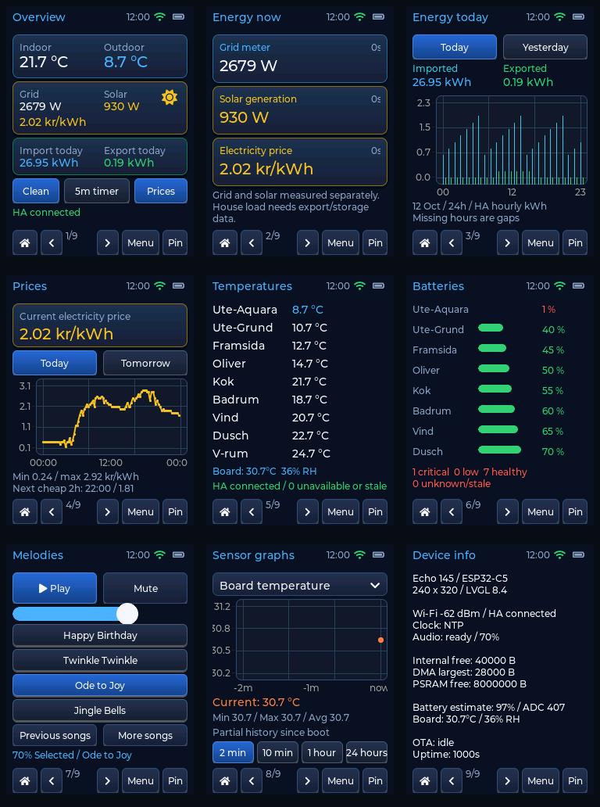

**Review implementation — firmware v144 (12 October 2026)**

**Appearance restored in v145:** original navy backgrounds and blue, yellow,
green accents are restored, including the sun glyph and primary blue controls.
Cards and buttons use restrained vertical shading and borders for depth. Live
readings retain their semantic colors; missing/stale values remain muted. This
appearance update retains the page arrangement and all functional fixes below.
The native preview reflects v145.

The ten defects in [the review](../REVIEW-2026-10-12.md) are addressed in the
working tree. The change also implements the modular UI, three energy pages,
clearer navigation/data state, RTC synchronization, optional pickup wake,
configurable battery estimates and idle amplifier shutdown. Existing changes
from before this task are retained. No firmware was flashed and no HA
configuration was modified.

| Review finding | Implementation |
| --- | --- |
| Play cancels its own new session | Nonblocking queue admission/cancel publication is indivisible with respect to task scheduling on the single-core C5; the consumer starts afterwards. Queue rejection changes no playback state. |
| Pump can lose a replacement command | Consumer-owned pending slot coalesces plays without putting commands back into a concurrently filled queue; later Stop clears pending playback. |
| Price response overflows | 32 KiB bounded PSRAM body; full JSON parsing; overflow and unit errors are explicit per entity. The captured regression fixture is larger than the old 4 KiB limit. |
| Volume stays disabled / asynchronous deltas | Readiness refresh enables controls; slider sends absolute targets; rejected commands show feedback. |
| Wake/idle observation | Input driver wrapper tracks every physical stroke and suppresses a waking/locked stroke until release, before target callbacks execute. |
| Grid data labelled as solar/house use | Stable grid-import/export roles and truthful labels; live house load requires additional real measurements and an explicit no-storage configuration. |
| Stale graph current/window statistics/ticks | Frequent current refresh, retained multirange history for all metrics, window-scoped statistics, explicit gaps and inverse Y scaling. Range/metric selection does not clear collection. |
| Malformed WAV chunk arithmetic | Shared, tested size-bounded RIFF parser rejects wrapped/out-of-RIFF chunks and validates PCM format. |
| WAV fragmentation/control/filename defects | Incremental header up to 16 KiB, carried odd byte, exact data length, command-owned filename and common Stop/volume/mute processing for songs, tones and WAV. |
| HA freshness/health | Per-entity received/check timestamps and result; last good values retained and dimmed on errors/staleness; HA connectivity separated from individual data availability. |
| Audio status/generation synchronization | Full lifecycle snapshots use one status lock; cancellation increments/reads are atomic; diagnostic register reads serialize with codec sessions. |

The former Pause action was a stop. It is now labelled **Stop**, and Play
restarts the selected song. True pause/resume is intentionally not claimed.
Song selection and browsing are separate from playback, with an explicit
selected/playing/status line. Playback failures and admission failures are
visible.

**Pages and data contracts**

Nine pages are registered in `main/ui/ui_shell.c`: Overview, Energy now,
Energy today, Prices, Temperatures, Batteries, Melodies, Sensor graphs and
Device info. Each page owns its state; shared cards/rows/buttons/chart
formatting and long-lived styles live in `ui_widgets.c`. The shell owns tile
roots, navigation, clock, touch gating, dimming, cleaning lock, five-minute
countdown and page pinning. Only the active page is presented/refreshed;
local graph collection remains active independently. Page construction occurs
once to avoid recreating hundreds of objects during swipes.

Adding a page means implementing its create/update callbacks, registering a
descriptor, and adding its source to `main/CMakeLists.txt`. New pages should
use shared widgets and the snapshot model, not perform network or codec I/O
from an LVGL callback. If dynamic destruction is introduced, remove collection
timers before freeing page state; the graph module provides its teardown.



The preview is generated by `tools/preview_ui.py` from production page code
with the actual LVGL 8.4 renderer and simulated sensors/audio. It is a layout
and interaction check, not a photograph of the flashed display or a claim
that preview sample consumption is current real consumption.

Overview includes the current electricity price. Its weather values use the
HA indoor/outdoor roles. Board temperature/humidity are labelled separately on
the temperature page; comfort advisories explicitly refer to the board
sensor. Sensor-battery summaries include unknown/stale entries.

Catalogue entries have stable `role` and canonical `unit` fields. Names are
presentation only. Counts are limited to nine temperature, eight battery and
six power entries, with generated compile-time assertions. UTF-8 byte limits,
role uniqueness, unit/role compatibility and C string safety are validated.
The normal firmware build fails if generated bindings are stale.

Actual HA units are normalized to C, percent, W, kWh and SEK/kWh; unsupported
units are rejected rather than relabelled. Power entries poll every ten
seconds, temperatures every thirty seconds, price and sensor batteries every
five minutes. Each successful or failed entity is published immediately.
Freshness thresholds are 45 seconds for power/daily energy, 90 seconds for
temperatures and 15 minutes for price/batteries. A poll timeout is 1.5 seconds
per entity; offline sources can increase effective cadence. Missing values
remain unavailable; last good values have their age/result rather than being
replaced with fabricated zeroes.

Energy today queries HA `recorder/statistics_during_period` for hourly
**change** values in kWh. It handles 23/24/25-hour Swedish calendar days,
missing hours and today/yesterday selection. Live today's counters include
an incomplete current hour; bars reflect recorded hourly data and may lag.
Yesterday totals are the recorded available changes; gaps are explicitly
identified. It does not subtract resettable daily counters to invent hourly
energy. Recorder communication is read-only and runs on the HA task. OTA
pause interrupts the query and waits for its cleanup before acknowledging.

A bounded NVS cache stores one successfully queried day, no more frequently
than every six hours during continuous uptime. After an offline boot with a
trustworthy clock, it is used only when its date/bounds match the selected
day, labelled cached. It is a convenience cache, not the authoritative energy
ledger or a claim to persist every local sensor sample. HA remains the
historical source.

Price curves use `raw_today` and `raw_tomorrow` timestamped intervals, up to
100 per day, with `tomorrow_valid` respected. The chart uses elapsed minutes
for X positions and Swedish local-time labels. Negative prices and DST are
supported. The cheapest contiguous two-hour window is duration weighted,
rejects gaps and searches only remaining future time. At the end of the day
it reports that no two-hour window remains rather than recommending a past
window. The displayed price is the configured HA sensor's price, not an
invented household all-in tariff.

Your inspected HA Energy preferences had grid import/export, no configured
solar-energy source, and no individual-device energy entries. Consequently,
solar daily generation, self-consumption, autonomy, storage flows,
appliance breakdowns and tariff-specific cost panels need those real data
sources before they can be displayed accurately. Instant solar power already
exists and is displayed. `grid_export_power` is an optional catalogue role;
`CONFIG_ECHO_NO_STORAGE` defaults off and must only be enabled for a verified
system without storage and with separate import/export power measurements.
Even then, derived house load requires fresh measurements within five seconds
of each other.

**Hardware use and physical acceptance**

The RTC stores UTC using the installed PCF85063A driver's year convention. A
validated RTC with oscillator-stop clear and year 2021–2069 can seed system
time. NTP completion only publishes a flag; the sensor owner writes the RTC,
clears OS through the seconds-register write, and refreshes it at most hourly.
The diagnostics identify the time source. Test that the board's actual RTC
backup supply preserves time during the intended power-loss conditions.

Pickup wake can be enabled from Menu and defaults off. It observes a change
in the accelerometer vector at a one-second cadence with a refractory period;
it does not infer motion from uncalibrated gyro bias. This is polling-based
pickup wake, not a promised deep-sleep interrupt wake. Gyro, temperature,
humidity, RTC and battery diagnostics remain available. Temperature/humidity,
RTC and ADC polling stay on the slower five-second cadence.

The speaker amplifier is disabled between playback sessions. Wi-Fi remains
available for OTA and HA, and the screen dims after 60 seconds. Pin prevents
the two-minute home return; active audio also prevents forced home return.
Cleaning lock blocks input for 30 seconds and the waking touch performs no
underlying action.

Battery state of charge is explicitly estimated. Set measured full/empty ADC
references under **Echo board calibration** in `idf.py menuconfig`; invalid
bounds fail the build. Actual voltage calibration requires a multimeter and
a real pack; this task does not manufacture measurements. CPU/gyro duty,
interrupt wake, deep sleep and charging-state sensing need hardware profiling
before an unattended battery-runtime claim can be made.

The optional SD/local-audio, microphone/voice, display rotation and BLE/
Thread/Zigbee ideas from the review remain documented extension options,
not newly enabled peripherals. They are not necessary for the energy panel
and require additional hardware/data/interaction choices. SD must reuse the
LCD SPI bus with MISO GPIO8 and CS GPIO23. Flash is already used for the bounded
energy cache. Microphone capture must use the existing I2S pair and one audio
owner. Rotation must update display and touch mapping together. Additional
radios need a defined HA integration and coexistence/power testing.

The working DMA draw-buffer configuration is preserved; large response,
price, graph-history and UI-state allocations live in PSRAM. Do not use
aggregate free heap as evidence that internal DMA allocations will fit.

**Verification**

Run from the repository:

```sh
make -C core/test test
python3 tools/test_audio_service.py
python3 tools/test_gen_entities.py
python3 tools/gen_entities.py --check
python3 tools/preview_ui.py
source /Volumes/repo/esp/esp-idf/export.sh
idf.py build
```

The host suites include 49 existing policy checks, 114 review-regression
checks with ASan/UBSan, 15 catalogue cases, and execution of actual audio
admission/pump functions with a preempting queue mock. The LVGL preview checks
all nine pages for clipping and tests melody readiness, absolute volume,
selection-without-play and Stop interactions. Price and recorder fixtures
were captured read-only from HA, with credentials and identifying recorder
entity IDs omitted. Yesterday's live recorder query returned 24 import and
24 export hours. Host checks do not prove radio timing, audio quality or
physical touch behavior.

The first flash of these boot/UI changes should follow the repository's USB
procedure, then verify Play/Stop/replacement, volume/mute during every playback
mode, price on Overview, Today/Yesterday/Prices, dim-wake and held-finger
cleaning lock, pin/navigation, HA outage/reconnection, RTC resync/offline boot
and internal/DMA headroom. Keep firmware recovery available. No deployment
was performed as part of this source update.

**Audio follow-up and deployment**

Later OTA deployments restored the page colours and qualified the audio fix.
Successful PCM writes in v145–v148 did not establish speaker output. Settled
CH32 readback in v148 showed EXIO3 low despite a commanded high; LCD/touch
reset bits read high. In v149, reapplying only the PA direction drove EXIO3
high and the user confirmed sound. The permanent board-service implementation
checks the requested level, performs that recovery sequence if needed, and
reports failure. v150 hardware logs confirmed PA high during PCM and low
after playback. v151 also removes a startup PA write after service readiness
publication, so the audio owner exclusively controls the amplifier thereafter.
The working v149 I2S GPIO assignment and page appearance are preserved.

v151 (`app_sha=a7f64f1fd03410d6`) is deployed and marked VALID. After restart,
startup and another 400 ms test tone completed with PA on readback 1, off
readback 0, and audio error 0. The audio admission/pump regressions and ESP-IDF
build passed. The first v151 boot failed an ES8311 I2C initialization write;
audio recovered after restart. The subsequent boot reported reset reason
`panic`; the available post-boot log contains no prior crash trace, so its
cause is unresolved. This check establishes successful playback on the final
boot, not reliability across every future boot. Audible confirmation was
provided by the user on v149.
